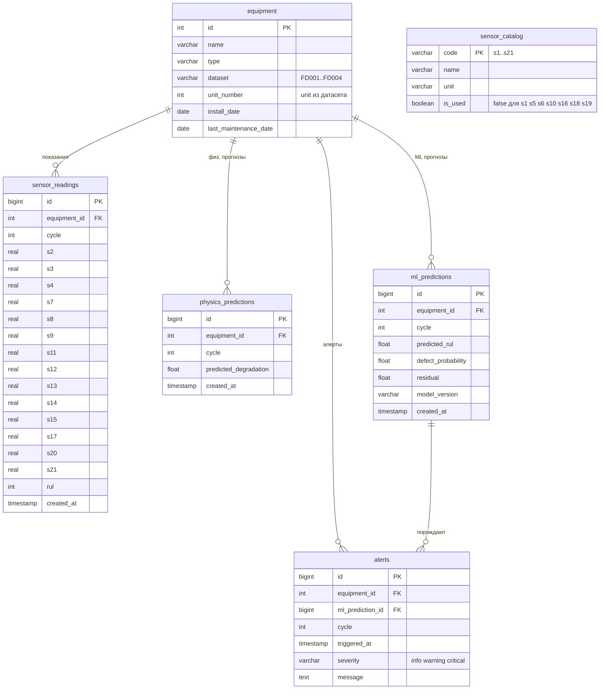

## Стек технологий

Язык (backend): Python  
Язык (frontend): TypeScript  
ML/DL: PyTorch, XGBoost  
Вычисления: NumPy, SciPy  
Backend: FastAPI  
Frontend: React  
База данных: PostgreSQL  
Инструменты автоматизации: Ollama

## Определение проблемы и формулировка темы

Промышленные предприятия вынуждены проводить плановое техническое обслуживание оборудования по жёсткому графику, даже когда оборудование находится в исправном состоянии. Это приводит к избыточным затратам на человеческие ресурсы и простоям производства. При этом отказ от планового обслуживания в пользу обслуживания «по факту поломки» несёт риск внезапных аварий. В результате предприятия вынуждены выбирать между переплатой за избыточное обслуживание и риском пропустить развивающийся дефект.

## User Stories

1. Как инженер по эксплуатации, я хочу видеть текущий прогноз остаточного ресурса каждой единицы оборудования, чтобы планировать техобслуживание по факту приближающегося дефекта, а не по жёсткому графику.

2. Как ответственный за производство, я хочу получать уведомление, когда состояние оборудования становится критическим, чтобы оперативно среагировать до внеплановой остановки или аварии.

3. Как инженер по эксплуатации, я хочу видеть историю показаний датчиков и отклонений от физически ожидаемого поведения оборудования, чтобы понимать, как развивался дефект, и точнее диагностировать его причину.

## Данные

Обучающие данные — NASA C-MAPSS (симуляция деградации турбовентиляторных двигателей), файл `train_FD001.txt`: 100 двигателей, 20 631 строка, жизнь двигателя от 128 до 362 циклов (в среднем 206), один режим работы, пропусков нет. Каждая строка — один цикл двигателя: `unit`, `cycle`, 3 операционные настройки, 21 датчик.

**RUL** (остаточный ресурс, в циклах) размечается как `rul = последний_цикл_двигателя − текущий_цикл`; в последнем цикле `rul = 0` (отказ). Для обучения дополнительно используется `rul_clipped` — RUL с потолком 125 циклов (на раннем этапе жизни износ по датчикам не виден). Разметка: `ml/prepare_rul.py`.

**Датчики.** В работе остаются 14 из 21: `s2, s3, s4, s7, s8, s9, s11, s12, s13, s14, s15, s17, s20, s21`. Исключены 7 датчиков без информации об износе: `s1, s5, s10, s16, s18, s19` (константы) и `s6` (почти константа). Операционные настройки `op1–op3` в FD001 — шум/константа, в модель не идут. Для FD002–FD004 (6 режимов работы) датчики по константности не удаляются — требуется нормализация по режимам.

| Датчик | Что измеряет | Ед. | Связь с RUL (Спирмен) |
| ------ | ------------ | --- | --------------------- |
| s2 | T24 — температура на выходе КНД | °R | −0,63 |
| s3 | T30 — температура на выходе КВД | °R | −0,61 |
| s4 | T50 — температура на выходе ТНД | °R | −0,70 |
| s7 | P30 — давление на выходе КВД | psia | +0,68 |
| s8 | Nf — физическая скорость вентилятора | об/мин | −0,57 |
| s9 | Nc — физическая скорость ядра | об/мин | −0,32 |
| s11 | Ps30 — статическое давление на выходе КВД | psia | −0,72 |
| s12 | phi — расход топлива / Ps30 | pps/psia | +0,69 |
| s13 | NRf — приведённая скорость вентилятора | об/мин | −0,57 |
| s14 | NRc — приведённая скорость ядра | об/мин | −0,20 |
| s15 | BPR — степень двухконтурности | — | −0,67 |
| s17 | htBleed — энтальпия отбора | — | −0,63 |
| s20 | W31 — охлаждающий отбор ТВД | lbm/s | +0,65 |
| s21 | W32 — охлаждающий отбор ТНД | lbm/s | +0,66 |

**Подготовка признаков:** нормализация (параметры сохраняются для инференса), сглаживание (скользящее среднее/EWMA), скользящие признаки (среднее, std, наклон за 5–30 циклов) для XGBoost, окна по 30 циклов для нейросети на PyTorch. Разбиение train/val — по `unit`, не по строкам, чтобы не было утечки.

**Статусы оборудования по прогнозу RUL:** `normal` — более 75 циклов, `warning` — от 31 до 75, `critical` — 30 циклов и меньше.

## Масштаб системы

Целевая аудитория системы - инженеры по эксплуатации и ответственные за производство на промышленных предприятиях. При оценке масштаба в 10 000 уникальных пользователей в сутки предполагается, что система обслуживает порядка N предприятий с M единицами оборудования на каждом, где каждый пользователь в среднем совершает K запросов в день (просмотр дашборда, проверка истории, получение алертов). Основная нагрузка - read-запросы (просмотр данных), запись происходит асинхронно от симулятора/датчиков оборудования, а не от действий пользователей напрямую.

## Отказоустойчивость

При недоступности Telegram Bot API система применяет паттерн Circuit Breaker: после 3 неудачных попыток отправки подряд прекращает попытки на 60 секунд, чтобы не тратить ресурсы на заведомо неудачные запросы. Алерт при этом всё равно сохраняется в базу данных и отображается в интерфейсе.

При недоступности Open-Meteo API физическая модель использует последнее закэшированное значение погодных условий (кэш на 1 час). Если кэш пуст (например, при первом запуске) - модель работает без погодного фактора.

## Анализ нагрузок

### 1. READ / WRITE нагрузка.

Исходные допущения:

| Параметр                        | Значение                           | Почему                                               |
| ------------------------------- | ---------------------------------- | ---------------------------------------------------- |
| Пользователей в сутки           | 10 000                             | —                                                    |
| Единиц оборудования в системе   | 1 000                              | условно                                              |
| Частота показаний датчика       | 1 раз / 30 сек (1 цикл)            | типично для промышленного мониторинга                |
| Частота инференса модели        | 1 раз / 5 мин на единицу           | нет смысла считать прогноз чаще, чем меняются данные |
| Запросов пользователя за сессию | ~5-10 (дашборд + история + алерты) | из прошлой оценки RPS                                |

WRITE в БД идет не от пользователей, а от фонового simulator + ml / physics predictions: 1 000 / 30 + 1 000 / 300 + 1 000 / 300 ~40 записей в сек  
READ 10 000 * 8 запросов ~ 80 000, правило 80%/20%, 20% от 24 часов = ~5, 80% от 80 000 = 64 000, 64 000 / (5 * 3600) ~ 3.5 RPS в пик

### 2. Объём сетевого трафика

Средний размер JSON-ответа: ~10 КБ  
Запросов в сутки: 10 000 польз. × 8 запросов ≈ 80 000 запросов/сутки  
Трафик: 80 000 × 10 КБ ≈ 800 МБ/сутки ≈ ~24 ГБ/месяц

### 3. Расчет объемов дисковой системы с учетом требования по хранению данных за период > 5 лет

Показания датчиков (таблица `sensor_readings`, широкая строка: 14 датчиков × 4 байта (`REAL`) = 56 Б + `id` 8 Б + `equipment_id` 4 Б + `cycle` 4 Б + `rul` 4 Б + `created_at` 8 Б + служебный заголовок строки PostgreSQL ~24 Б ≈ **110 байт**):  
33 записи/сек × 86 400 сек = ~2.88 млн строк/сутки  
2.88 млн × 110 байт ≈ 320 МБ/сутки → ~115 ГБ/год → ~580 ГБ за 5 лет (без индексов; индекс `(equipment_id, cycle)` добавляет порядка 30–40%).

Предсказания модели:  
6.6 записи/сек × 86 400 = ~570 тыс. строк/сутки.
570 тыс. × 50 байт ≈ 28.5 МБ/сутки → ~10 ГБ/год → ~52 ГБ за 5 лет.

## Архитектурные схемы

### Context


### Container


### Слои backend

```
api/v1 (эндпоинты, валидация) → services (бизнес-логика) → repositories (доступ к данным)
                                      └→ predictor (модель RUL: заглушка → XGBoost/PyTorch)
```

Репозиторий — интерфейс `EquipmentRepository`. Сейчас работает `MockRepository` (данные в памяти, похожие на FD001), позже — `PostgresRepository`. Переключение: `OFFTECH_USE_MOCK_REPOSITORY`. Эндпоинты и фронтенд при этом не меняются.

## Контракты API

Все эндпоинты — с префиксом `/api/v1`. Документация OpenAPI: `/docs`.

### Оборудование

| Метод | Эндпоинт                   | Описание                             | Ожидаемый latency |
| ----- | -------------------------- | ------------------------------------ | ----------------- |
| GET   | `/equipment`               | Список всех единиц оборудования (с текущим циклом, статусом и прогнозом RUL) | < 200 мс |
| GET   | `/equipment/{id}`          | Информация об одной единице          | < 100 мс          |
| GET   | `/equipment/{id}/status`   | Текущее состояние: статус, RUL, вероятность дефекта, невязка | < 150 мс |
| GET   | `/equipment/{id}/history`  | История показаний датчиков (`from_cycle`, `to_cycle`, `limit`) | < 500 мс |
| GET   | `/equipment/{id}/forecast` | Прогноз деградации: RUL по будущим циклам с доверительным интервалом | < 500 мс |

### Алерты

| Метод | Эндпоинт                 | Описание                           | Ожидаемый latency |
| ----- | ------------------------ | ---------------------------------- | ----------------- |
| GET   | `/alerts`                | Список последних алертов           | < 200 мс          |
| GET   | `/alerts/{equipment_id}` | Алерты по конкретному оборудованию | < 200 мс          |

### Прогнозирование

| Метод | Эндпоинт   | Описание                                                    | Ожидаемый latency |
| ----- | ---------- | ----------------------------------------------------------- | ----------------- |
| POST  | `/predict` | Ручной запрос инференса модели для конкретного оборудования | < 2000 мс         |

### Справочники и служебное

| Метод | Эндпоинт   | Описание                                      | Ожидаемый latency |
| ----- | ---------- | --------------------------------------------- | ----------------- |
| GET   | `/sensors` | Каталог датчиков (21, с признаком `is_used`)  | < 100 мс          |
| GET   | `/health`  | Проверка работоспособности (без префикса)     | < 50 мс           |

## Проектирование данных

Таблицы привязаны к структуре датасета C-MAPSS: одна единица оборудования = один двигатель (`unit`), одна запись показаний = один цикл (`cycle`). Обучающая выборка (`train_FD00X.txt` с разметкой RUL) хранится файлами в `data/`, а не в БД.



Ограничения и индексы: `UNIQUE (dataset, unit_number)` в `equipment`; `UNIQUE (equipment_id, cycle)` в `sensor_readings`, `physics_predictions`, `ml_predictions`; индекс `alerts (equipment_id, triggered_at DESC)`. Показания хранятся широкой таблицей: набор из 14 датчиков фиксирован, так запросы истории не требуют `PIVOT`. Для других наборов (FD002–FD004) добавляются колонки миграцией; полный список датчиков и признак `is_used` лежат в `sensor_catalog`.

При записи (40 записей/сек) все вставки идут в разные таблицы от фоновых процессов. 40 INSERT/сек — незначительная нагрузка для PostgreSQL.  
При чтении (~10-20 RPS) PostgreSQL будет находить строки за O(log n). Проблем не возникнет.

## Стратегия масштабирования

### 1. Backend (FastAPI)

При 100 000 — запускаем несколько экземпляров за балансировщиком нагрузки.

### 2. База данных

Основная нагрузка — чтение (дашборд, история, алерты).
Добавляем 1-2 read-реплики, куда направляем все GET-запросы.
Запись идёт только в primary

### 3. Кэширование

Часто запрашиваемые данные кэшируем в Redis, чтобы не ходить
в Postgres на каждый запрос

### 4. Кэширование внешних API

**Open-Meteo API:** Погодные данные меняются медленно - нет смысла запрашивать чаще
раза в час. Кэшируем ответ в Redis.

**Telegram Bot API:** Алертов немного, rate limit маловероятен.

### 5. Ml / Physics engine

- Запускаем несколько воркеров ML-engine параллельно,
каждый обрабатывает свой диапазон `equipment_id`
- Если CPU не хватает - батчинг: вместо инференса
по одной единице за раз, модель обрабатывает пачку, что намного эффективнее.
